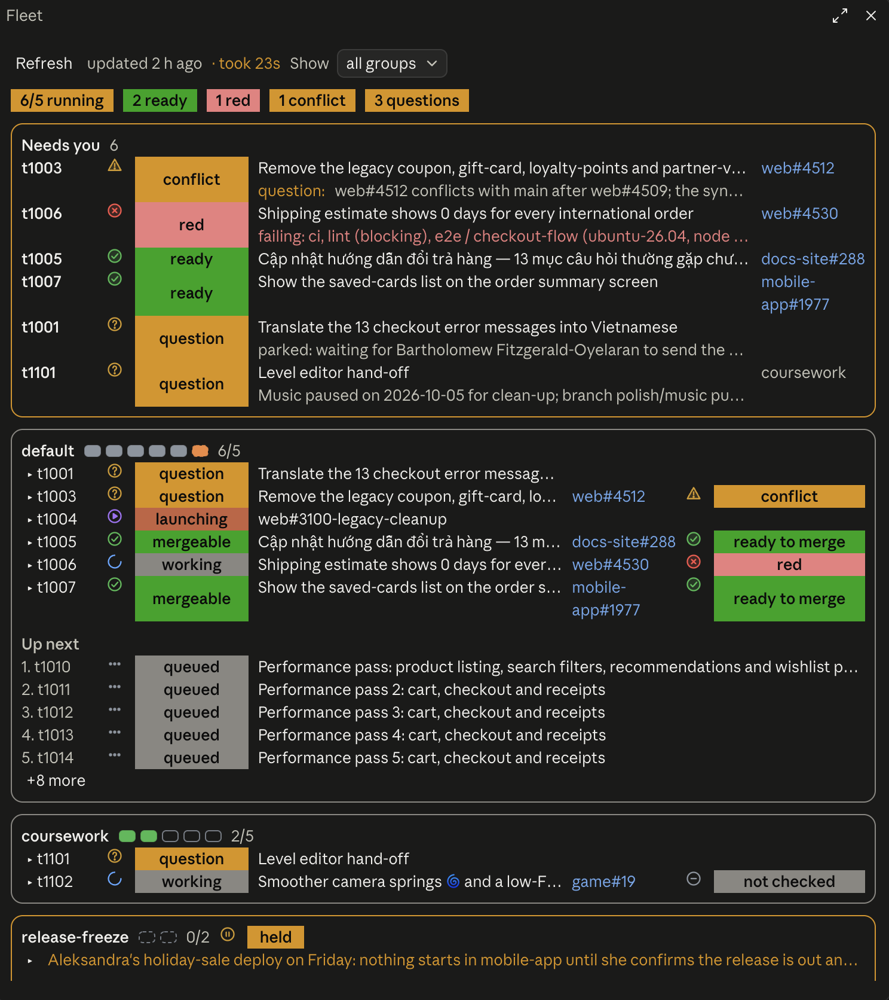

# claude-fleet

> **Retired, 2026-10-26.** The Claude Code desktop app now does most of what this plugin was for:
> one session can start another (`start_session`), the linked-sessions list shows who started what and how each is doing, a
> session reports back when it ends a turn, and `SendMessage` reaches any session by its id. I no longer use fleet,
> and there will be no more releases. 0.6.5 is the last version; it still installs, but nobody maintains it.
>
> The app has no equivalent for these: the queue and pool limit, tasks that wait on another task or a PR, held
> projects, file-overlap warnings, and the checklist gate. If you rely on one of them, pin 0.6.5.

A small helper for running a few Claude Code sessions side by side, one task each.



You queue the work; fleet starts the next task when a session frees up, and keeps a board of what each one is doing and what is waiting on you.

## What it might help with

- **Handing work off.** Any session can pass a task along with `fleet enqueue`, and it waits its turn in the queue.
- **Keeping things moving.** A few sessions run at once. When one finishes, stops to ask you something or opens a PR, the next task can start. The default of five is simply what one laptop handles comfortably; raise or lower it with `fleet config --max <n>`, per scope if you like.
- **Sessions that know about each other.** Each session can see the board, so if you send a message to the wrong one, it will usually point you to the session that owns that task and offer to pass the message on.
- **Overlaps noticed early.** Worktrees keep edits apart, but two tasks changing the same file can still conflict when they merge. Fleet notices the overlap while both are running, so the sessions can talk it through.
- **A quiet view of what needs you.** `/fleet-board` opens a pane and a line above your prompt that show PRs that are ready, red or in conflict, and any open questions. A small toast appears when something changes. The board is off until you open it: nothing is drawn and nothing is polled before the first `/fleet-board` in a session, and polling stops again once the pane is closed and the line is hidden. Set `FLEET_BOARD=on` in the environment to show the line and poll from the start of every session.
- **Waiting and pausing.** A task can wait for another task or for a PR to merge, a project can be held during a release, and one task can be moved to the front.
- **Picking up where you left off.** The brief, the task template and a daily journal are kept with the fleet, so a new session can take over the coordinating role.

### "Couldn't I just open the sessions myself?"

You can, and for two or three tasks that works well. Past that, you tend to become the bottleneck: noticing which session finished, remembering which one had which issue, choosing what comes next, and checking each PR for its status. Fleet takes care of that bookkeeping and lets you know when a person is actually needed.

### A note before installing

Fleet is ephemeral software. It was written for one person's day-to-day work and changes as that work changes. Commands, file formats and the board may shift between versions without a migration path, and parts of it may be retired once Claude Code does the same job natively. If you depend on it, pin a version and read the release notes before updating.

## Install

```bash
claude plugin marketplace add zAcherttp/claude-fleet
claude plugin install fleet@claude-fleet
```

Then ask Claude to *"fan these issues out in parallel"*, or open the board with `/fleet-board`.

Works on macOS, Linux and Windows. Needs Node 18+, git and the GitHub CLI (`gh`) for PR status.

<details>
<summary>The terminal view</summary>

```
slots 4/5
NAME   TASK  KEY              STATE      BRANCH             PR     NET  FILES  OVERLAP
alder  t001  acme/api#1650    mergeable  claude/alder-3f1   #1731  −1   6      —
birch  t002  acme/api#1652    working    claude/birch-9c2   —      +2   3      src/routes/sessions.ts ← cedar
cedar  t003  acme/api#1655    working    claude/cedar-11a   —      —    2      src/routes/sessions.ts ← birch
dogw   t004  acme/web#88      question   claude/dogw-7d0    —      —    1      —
queue (2)
  1. t006 acme/api#1661 Fix the export timeout
  2. t007 acme/api#1664 Retry the webhook on 502
```

</details>

<details>
<summary>How it works</summary>

- `bin/fleet` keeps one JSON file per task in `~/.fleet`, written atomically under a lock that recovers from a crashed holder.
- `skills/fleet` teaches Claude when to enqueue, launch, join, report state and clean up after a merge.
- `hooks/register.tsx` is a Claude Code mod that draws the board. It reads the board and **one** batched GraphQL query for every PR (about a second), and shows "no access" for repos your `gh` account can't read. It refreshes once a minute, only while the pane is open or the line above the prompt is shown.
- A task moves through `waiting → queued → launching → working → question | mergeable → verifying → done`. Only `launching` and `working` take a slot.
- Every launch prompt opens by asking the session to post a live checklist (`update_plan` in the desktop app, `TodoWrite` in the terminal) with an item for verifying and one for reporting back. A `PreToolUse` hook (`fleet hook-plan-gate`) reads the session's transcript and refuses `fleet state <id> mergeable` and `fleet state <id> done` while any item is open, listing them. A session with no checklist is let through with a warning, and `question`, `verifying` and `working` are never gated.

</details>

<details>
<summary>Tested</summary>

`fleet --self-test` runs 65 checks on Linux, macOS and Windows in CI: the pool limit, queue order, held tasks, dependencies, locks, hand-over, six concurrent enqueues producing exactly one task, and the checklist gate against synthetic transcripts in `lib/fixtures`. `claude plugin test .` runs 24 board tests on the terminal and the desktop at 36, 48 and 100 columns, including a worst-case board (`FLEET_BOARD_FIXTURES=1`, `/fleet-board worst`), a plain message for each way a refresh can fail, and the opt-in: no line and no poll by default, both after `/fleet-board`, both from the start with `FLEET_BOARD=on`, and no poll once the line is hidden with no pane up.

</details>

MIT licensed.
